# Embedded SW/SYS engineer  
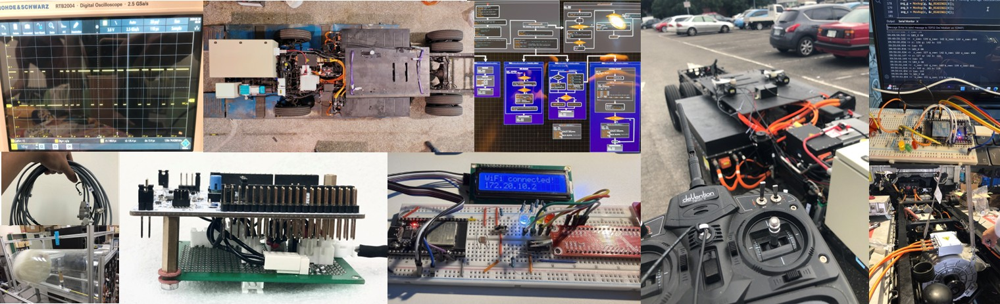  
*Hi I'm Kevin Lee, former Sr. Firmware Engineer at Delta Electronics with 3+ years of automotive electronics experience. Currently pursuing an M.S. in Embedded & Cyber-Physical Systems at UC Irvine. I'm passionate about creating reliable embedded software, system—and living a curious life connected to nature and people.*

**M.S. Embedded & Cyber-Physical Systems Graduate Student**, UC Irvine
**M.S. Mechanical Engineering**, National Taiwan University 

[🗂️ My Resume <<-------------](resume.md)  

---
## 🤝Let's Connect 
[LinkedIn](https://www.linkedin.com/in/kevin-lee-253645167) | [GitHub](https://github.com/kevin-chengchihlee) | [✉️kevin.chengchihlee@gmail.com](mailto:kevin.chengchihlee@gmail.com) | Irvine, CA  

---

<strong>📑 Table of Contents — Projects</strong>

<ol>
  <li><a href="#hybrid-powertrain">Range-Extended Hybrid Powertrain for MotorBike</a></li>
  <li><a href="#x-by-wire">X-by-Wire Control EV Truck Platform</a></li>
  <li><a href="#canfd">CANFD Tranceiver Module</a></li>
  <li><a href="#max32660-i2s">Analog Devices MAX32660 with I²S MEMS Microphone</a></li>
  <li><a href="#traction-inverter">Infineon Aurix EV Traction Inverter Embedded SW</a></li>
  <li><a href="#lightswarm">LightSwarm Network</a></li>
  <li><a href="#face-swapping">Face Swapping</a></li>
  <li><a href="#camera-p5v04a">p5v04a Camera Shot with RaspberryPi 5</a></li>
</ol>

## 🚀Projects
---

- ## Range-Extended Hybrid Powertrain for MotorBike:  
**Energy Management Strategy development and VCU prototyping.** 
*NTU Advanced Power R&D Center*   
C|SIMULINK|STM32|CANBUS|dSPACE| 
Real-Time System|Automotive   
  [⚙️Check for more detail](proj_vcu_ems.md)   
  In this project, a hybrid-powertrain was proposed with the prototype made. I was responsible for the Energy-Management-Strategy design and development on a VCU prototype.  
The VCU Prototype with energy-management-strategy embedded SW and CANBUS.
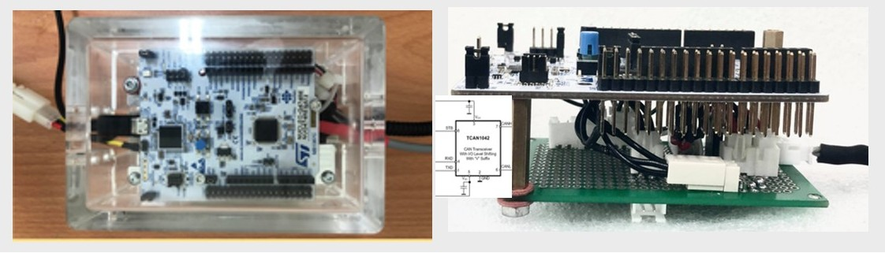
 CiL test with dSpace through drive cycle and vehicle model.
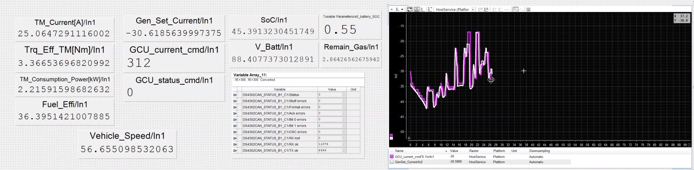
Software StateChart & VCU in operation.   
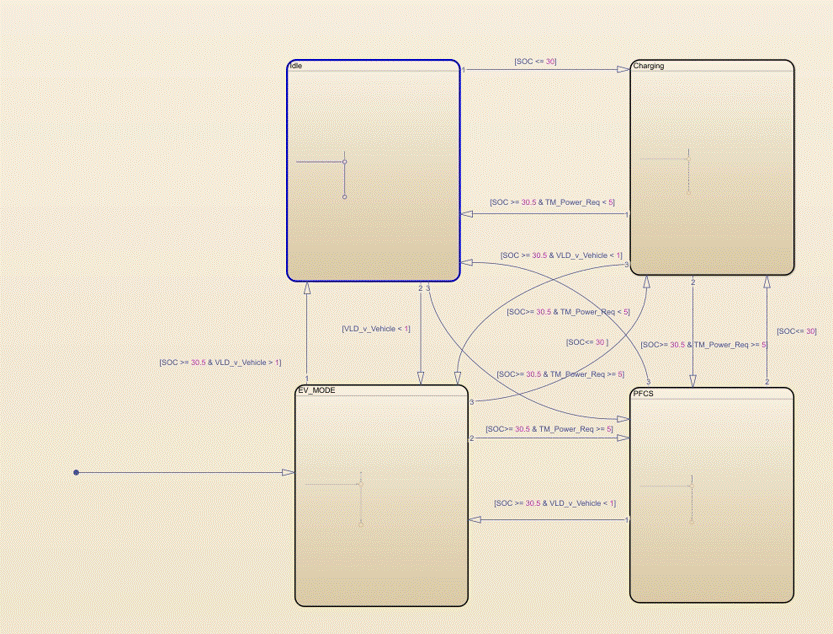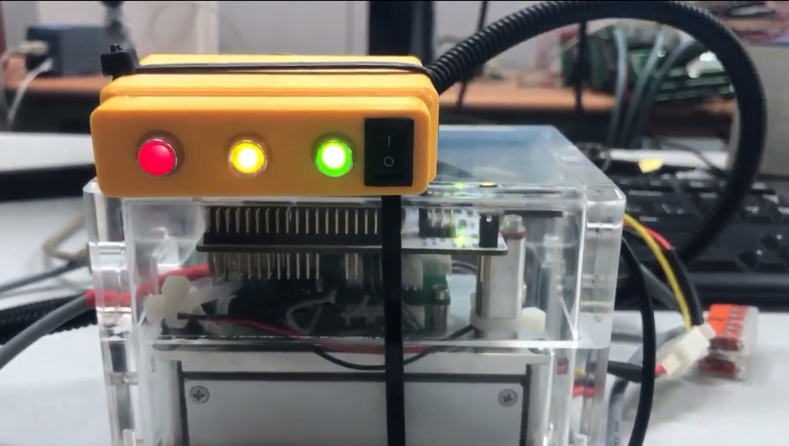

---

- ## X-by-Wire Control EV Truck Platform:  
**Fully by-wire controled EV truck platform development and HiL V&V platform development.** 
*NTU Advanced Power R&D Center*   
EV|C|SIMULINK|STM32|CANBUS|dSPACE| 
Real-Time System|Automotive|HiL|   
  In this project, an X-by-Wire controlled BEV truck platform and a corresponding Hardware-in-the-Loop (HiL) subsystem platform were proposed and developed. By performing detailed modeling and simulation of the vehicle and its subsystems, the architecture and specifications for both the truck and the HiL platform were defined.     
  All subsystems were then developed and integrated into a closed-loop HiL environment using dSPACE for real-time vehicle dynamics and environment simulation. Finally, the subsystems were deployed on the target vehicle and successfully validated through a proof-of-concept (PoC) test run.     
  The top-view of the developed vehicle. There's no cockpit since it's fully by-wire/remote controlled.
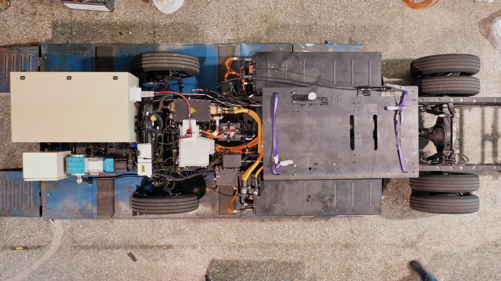
  One test run of the vehicle. The big box at the front contains all subsystem controllers.
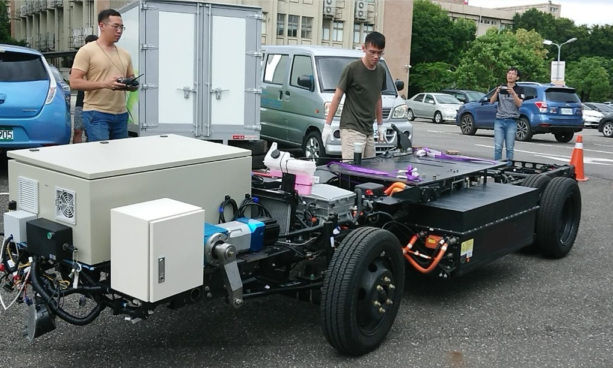
  dSPACE Model Desk.
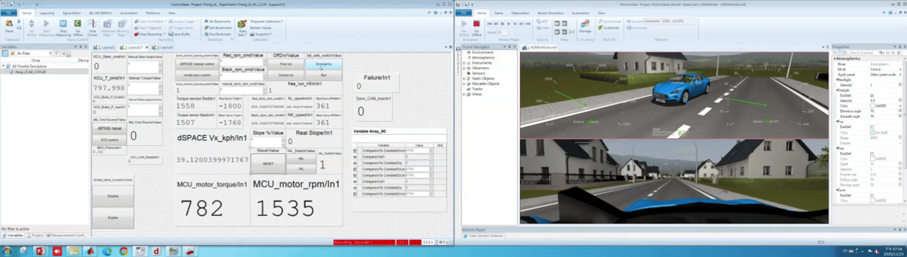
  Traction Motor HiL Platform.
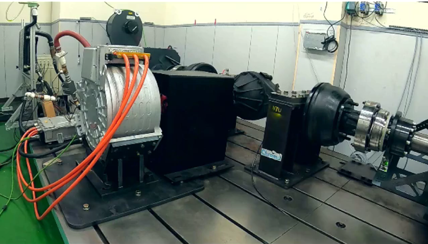
  Steering System HiL Platform.
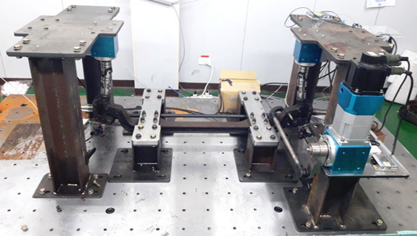

---

- ## CANFD Tranceiver Module:  
**CANFD Tranceiver Module with TCAN1042 and STM32.**   
C|STM32|CANFD|Time Quantum|PCB   
  [🗂️Repository](https://github.com/kevin-chengchihlee/STM32_CANFD/tree/master)  [⚙️To be updated...](-)   
  
**Hardware Design**  
Designed a custom CAN FD transceiver PCB based on Texas Instruments TCAN1042  
Integrated key supporting components, including:  
  Common-mode choke for EMI suppression   
  Termination resistor for impedance matching   
  Power conditioning and protection circuitry  
Fabricated and assembled a working prototype board  

**Embedded Software Development**  
Used an STM32 evaluation board for driver and firmware implementation     
Configured FDCAN peripheral for CAN FD communication  

**Implemented:**  
Frame transmission and reception  
Interrupt-driven message handling  
Loopback testing for early validation  

**System Configuration & Testing**  
Configured CAN FD with:  
500 kbps nominal bitrate  
2 Mbps data phase bitrate  

**Verified functionality in two stages:**  
Internal loopback mode (software validation)  
Physical bus testing (hardware + network validation)  

**Results**  
Successfully achieved reliable CAN FD packet transmission and reception  
Validated full communication chain:  
MCU ↔ Transceiver ↔ Physical Bus ↔ Node  
Demonstrated stable performance under real bus conditions  

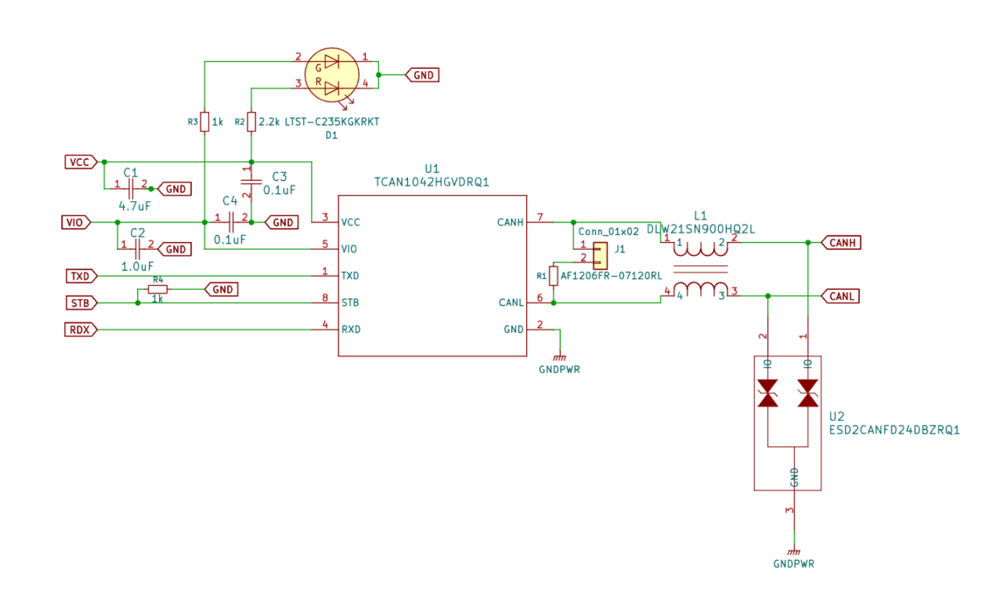
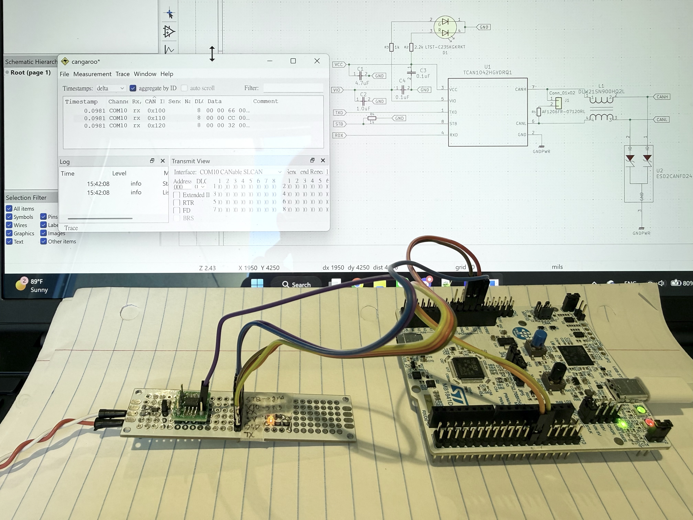
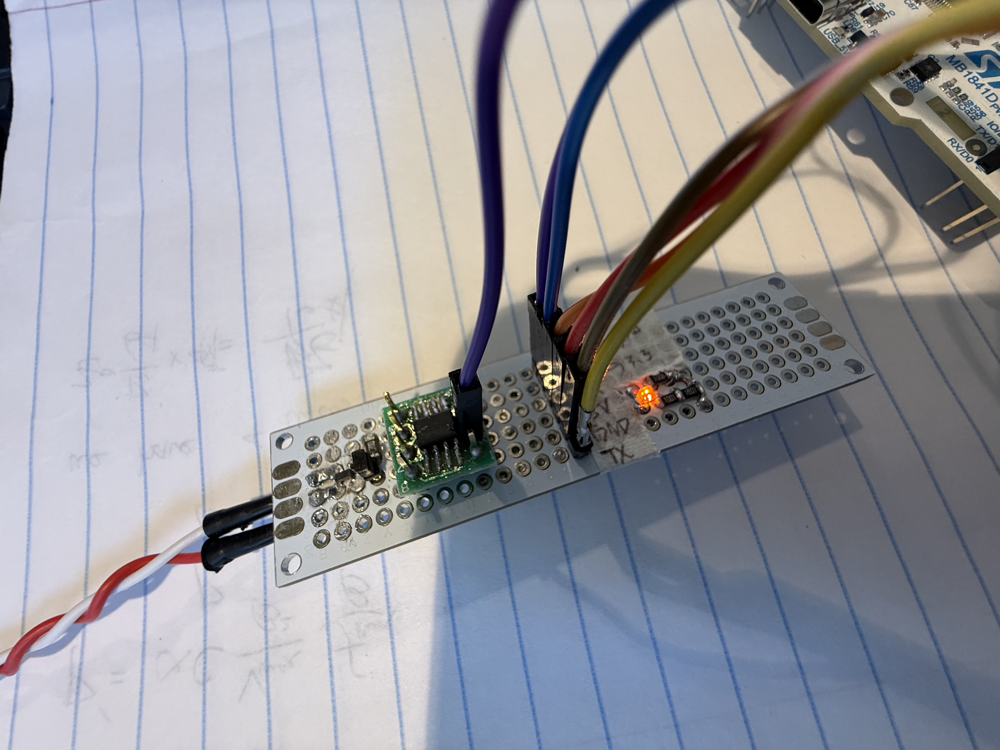  
  

---

- ## Analog Devices MAX32660 with I²S MEMS Microphone
**SPI-Based I²S Microphone Interface Using ARM Cortex-M4.**  
C | ARM Cortex-M4 | SPI | I²S | DMA | MEMS Microphone | Embedded Systems   

**Technical Challenge**  
The MAX32660's native I²S interface supports 16-bit words, while the ICS-43434 microphone requires 32-bit slots with 24-bit audio data.  
This project explores an SPI-based workaround to bridge the format mismatch.

**Hardware Design**  
Interfaced the Analog Devices MAX32660 microcontroller with an Adafruit 6049 (ICS-43434) digital MEMS microphone.  
Designed an SPI-based interface to emulate I²S communication.  
Mapped SPI SCK, MISO, and MOSI signals to the microphone's BCLK, SD, and WS connections.  

**Embedded Software Development**  
Developed embedded C firmware targeting the ARM Cortex-M4 microcontroller.
Configured SPI to generate I²S-compatible clock and word-select signals.
Used predefined SPI MOSI patterns (0x0000 0x0000 0xFFFF 0xFFFF) to generate the WS signal.  
Investigated DMA-based SPI transmission and reception for continuous audio sampling.  
Designed bit alignment and extraction logic to recover 24-bit microphone samples from received SPI data.  

**System Configuration & Testing**  
Prototyped the SPI-based I²S workaround on MAX32690 before porting to MAX32660.
Captured SPI-generated clock and WS waveforms using a logic analyzer.   
Verified word-select transitions and clock synchronization.  
Investigated the I²S one-bit data delay and corresponding sample alignment requirements.  

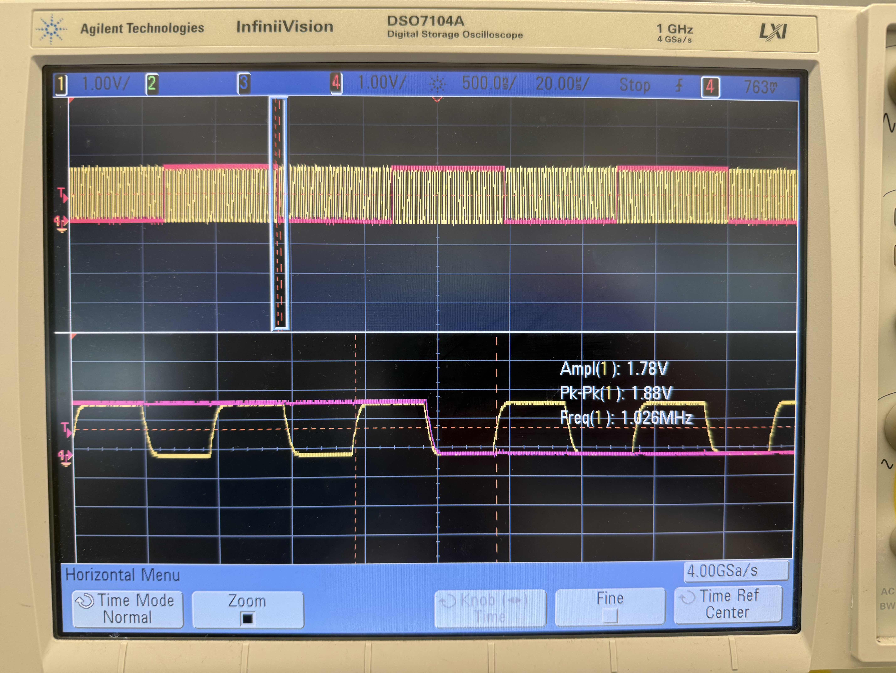
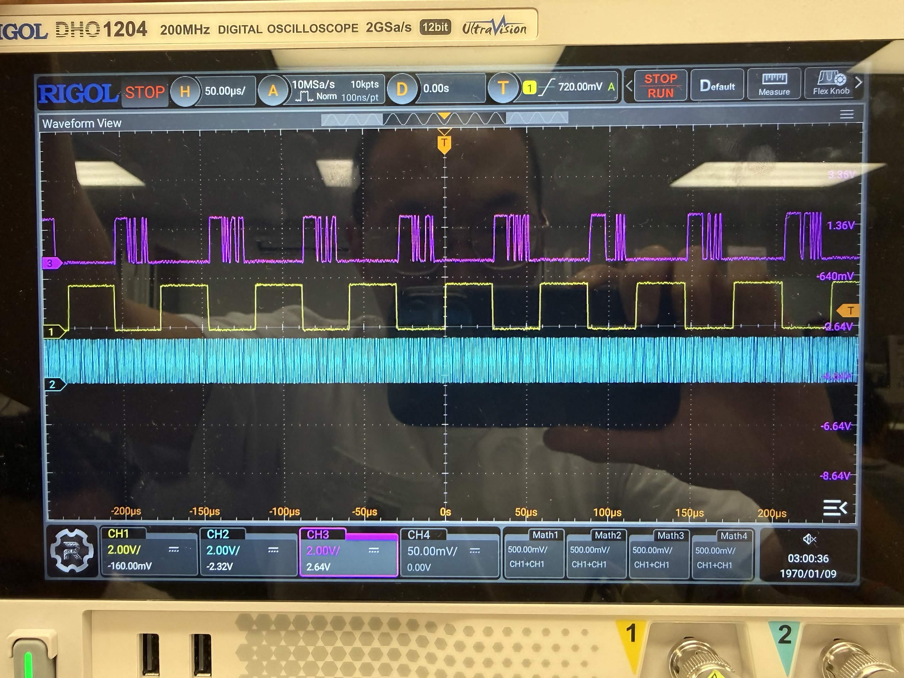  

**Captured Microphone Audio**
<audio controls preload="metadata">
  <source src="assets/proj_spi_drive_i2s/recording_new.wav" type="audio/wav">
  Your browser does not support audio playback.
</audio>

[Download Audio Recording](assets/proj_spi_drive_i2s/recording_new.wav)

---

- ## Infineon Aurix EV Traction Inverter Embedded SW:  
*Delta Electronics Inc.*   
C|Python|InfineonAurix|dSPACE|ASPICE|HiL| 
Jenkins|VectorCAST|MISRA C   
  Development of the Embedded SW of an EV Traction Inverter, including CPU load analysis and optimization. During this project, the automated verification pipeline was also established for saving ~85% labor per SW release.

---

- ## LightSwarm Network:  
**IoT self-organizing network.**   
C|Python|ESP32|RaspberryPi|UDP|FreeRTOS|Real-Time Sys   
  [🗂️Repository](https://github.com/kevin-chengchihlee/LightSwarm)  [⚙️Check for more detail](proj_lightswarm.md)   
  
  In this project, a self-organizing LightSwarm is developped with communication through UDP. Multiple ESP32s are the swarm device and a RaspberryPi 5 as a master device for monitoring.   
  The system flow-chart of the swarm network.
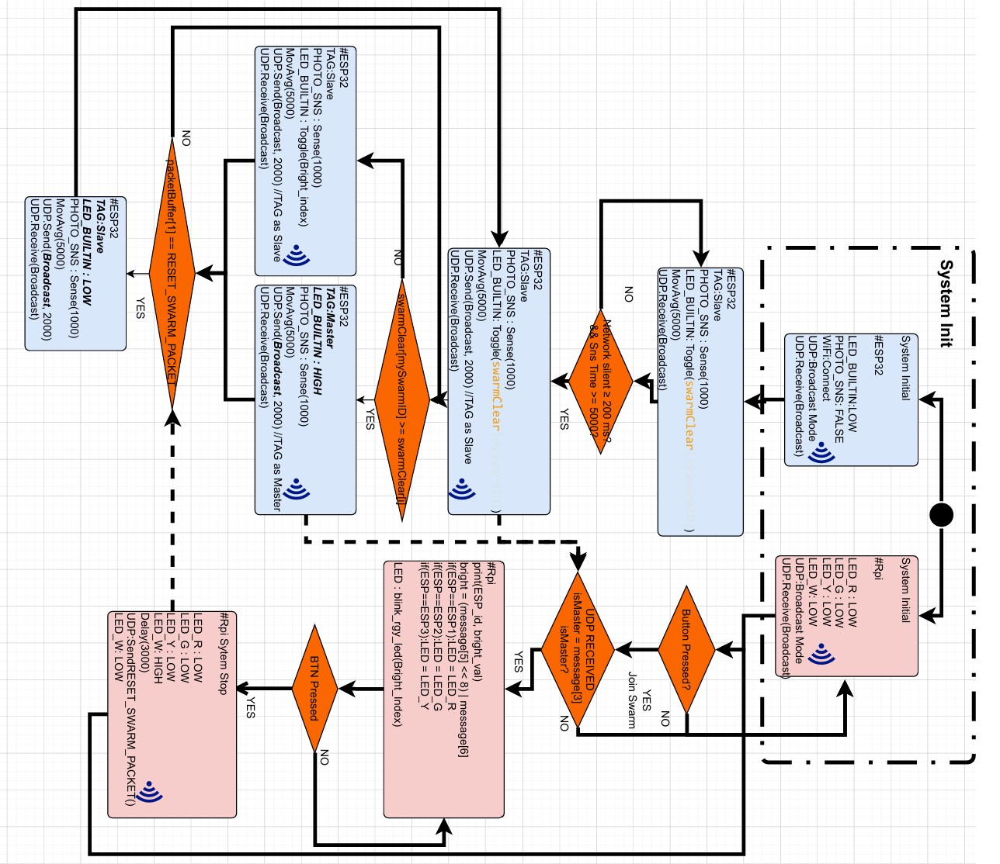  

---

- ## Face Swapping:  
**Detecting faces in camera image and swapping with emojis**   
Python|Raspberry Pi 5|Camera|   
Team: [codersrule](https://github.com/codersrule) | [gigaray](https://github.com/gigaray)   
  [🗂️Repository](https://github.com/codersrule/REPLACE-HUMAN-HEADS-WITH-CAT-HEADS)  [⚙️Check for more detail](proj_face_swap.md)   
  
  This is a group project. In this project we used the RPi 5 and camera p5v04a to capture live images and detect human faces with cv2 to return the coordinate and area of faces detected. An image with 16 emojis is prepared for cropping and background removing. After these two parts are ready, the cropped emoji will be resized and placed on the image.   
   This is the emoji collection to use.
    
   Before face swapping.
  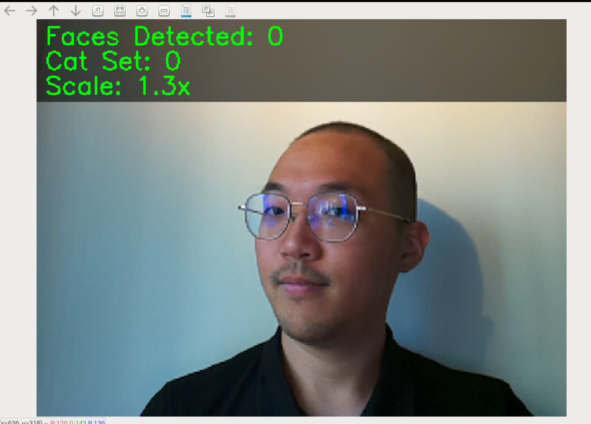  
   After swapping.
  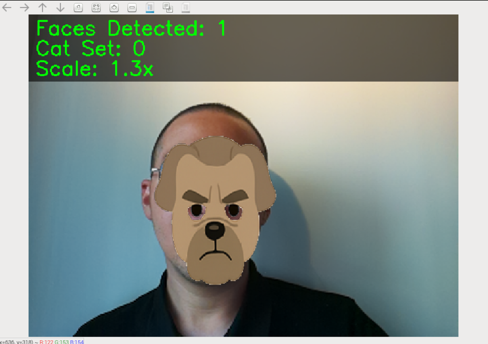  

---

- ## p5v04a Camera Shot with RaspberryPi 5:  
**Driving p5v04a with RPi**   
Python|Raspberry Pi 5|Camera|   
  [🗂️Repository](https://github.com/kevin-chengchihlee/p5v04a_camera_easyshot)  [⚙️Check for more detail](proj_camera_p5v04a.md)   
  
  This is a small part of a group project. I'm responsible for developing the camera APIs for further integration.
  In the repository, the scripts would run an easy image taking application. With input "s" or "q" for taking shots and quitting. The images would be stored in the same directory. 
  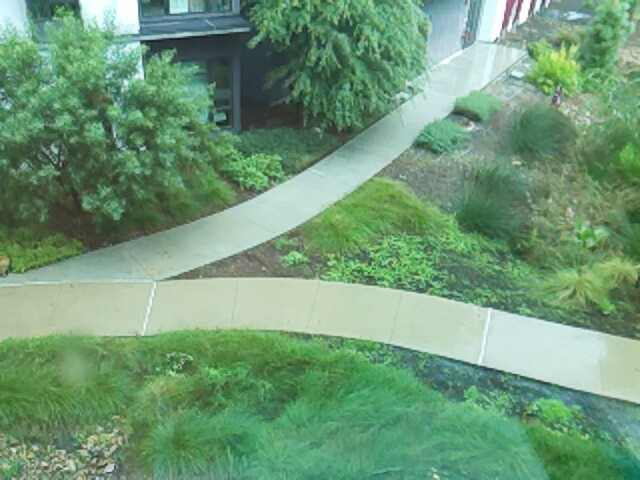  

---
